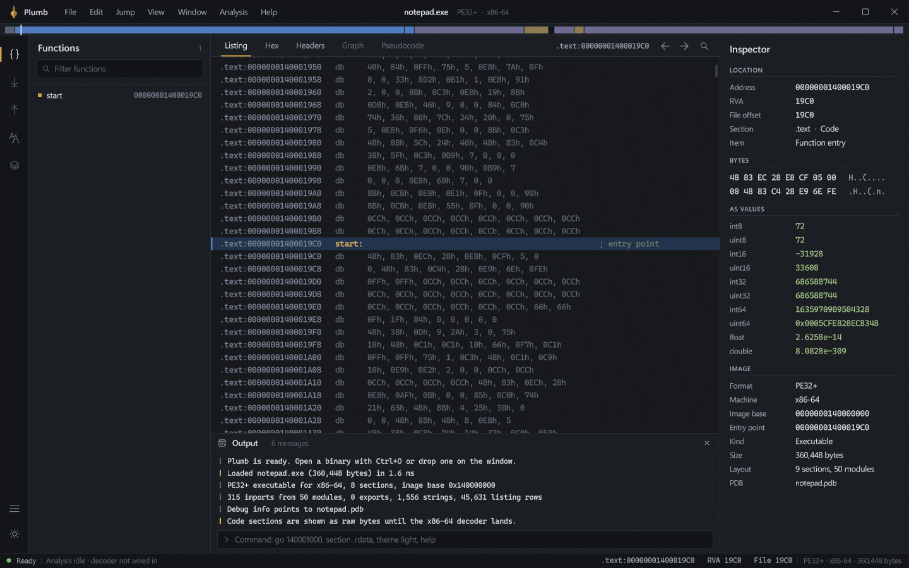
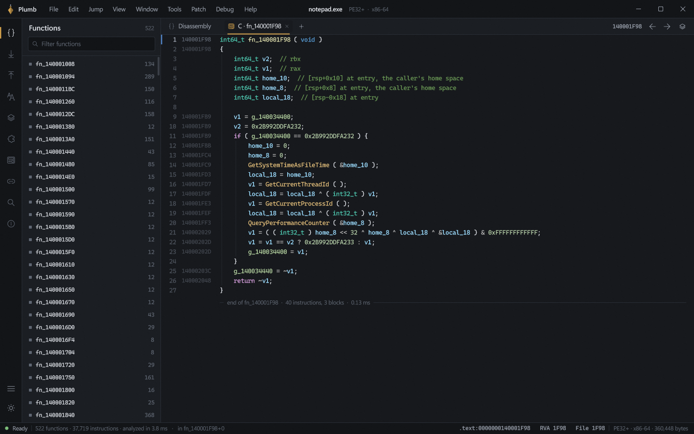
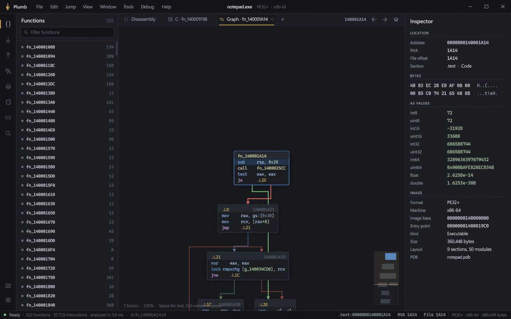
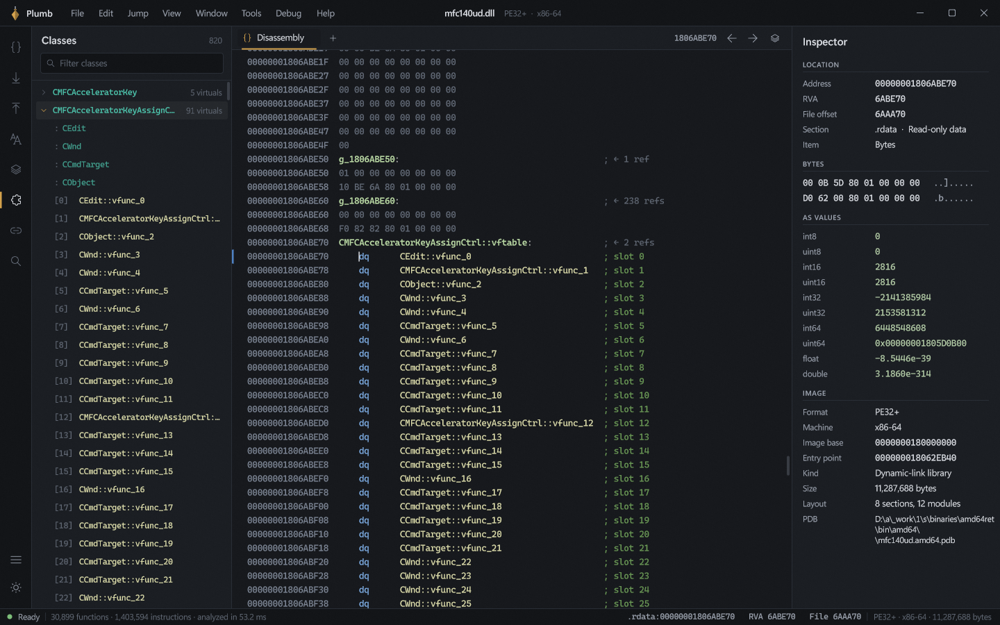
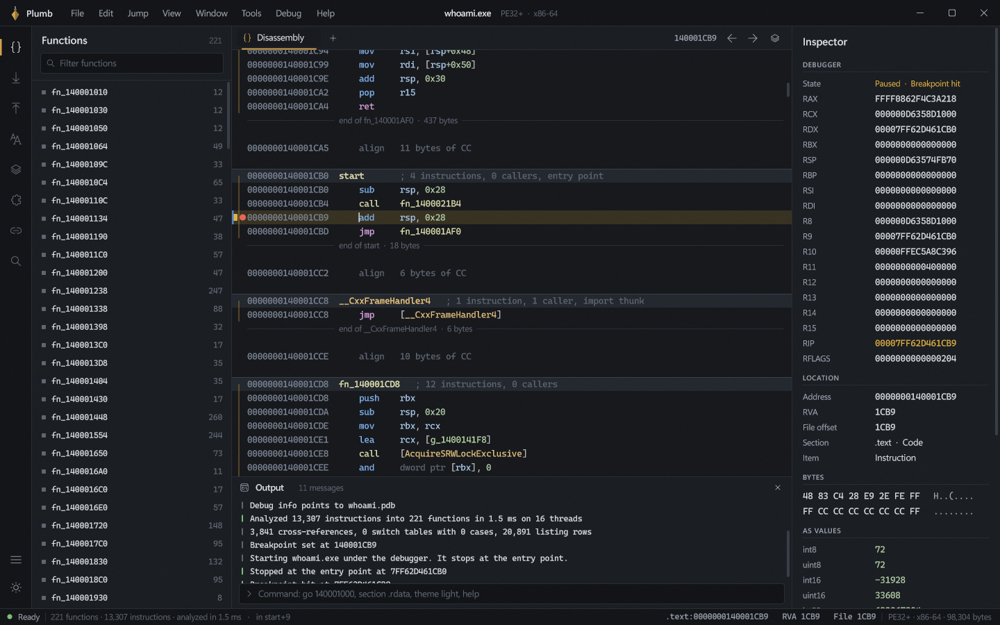
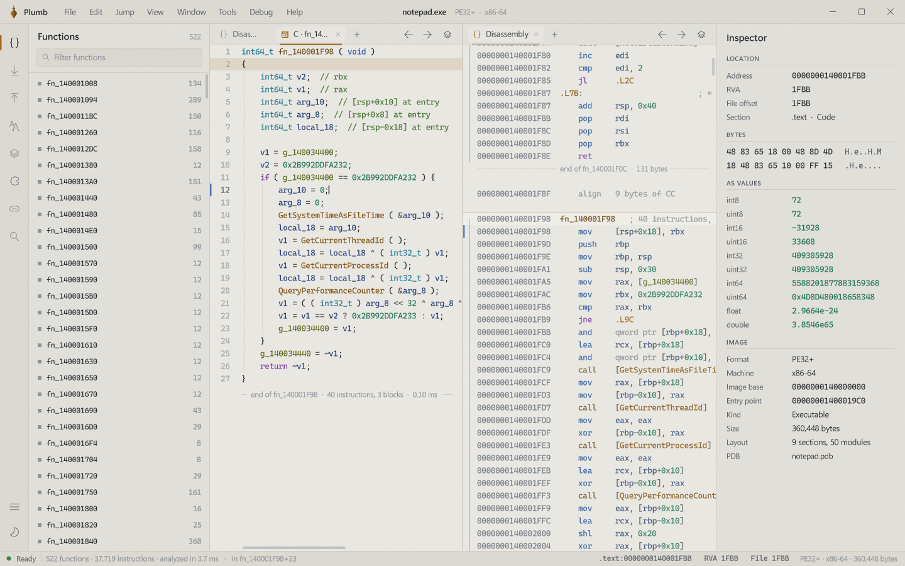

# Plumb

A disassembler, decompiler and debugger for Windows executables. Plumb is written in C++ with no C runtime and no third-party code, and the whole program is a single executable.



## What it does

### Disassembly

- Table-driven x86 and x86-64 decoder covering the legacy, VEX and EVEX (AVX-512) encodings. It matches llvm-objdump on more than 99% of instructions in the system DLLs it was tested against.
- Text listing with full-width addresses, labels, function boundaries and `end of` markers, alignment padding, string and import rows, switch tables and vtables.
- The listing behaves like a text editor. Click to place a caret, then drag or Shift-click to select any span (a register, an operand or whole lines) and Ctrl+C copies exactly that. Double-click a name to follow it, or anything else to select the word.
- Opcode bytes are hidden by default. Turn them on under Window.
- Number display per instruction: hex or decimal (H), character (R), binary (B) and float (F). Immediates that look like floats get a `float 1.0` hint.
- Graph view (Space) with layered layout, colored edges (taken, not taken, unconditional, switch case), zoom, pan and a minimap.

### Analysis

- Multithreaded recursive descent seeded from the entry point, exports, TLS callbacks, `.pdata`, code pointers in data (including vtable runs) and prologue scans. A 19 MB code section is done in about 150 ms on 16 threads.
- Cross-references for calls, jumps, reads, writes and pointers. X lists the references to the name under the caret, whether that's a call target, a global or the function you're in.
- MSVC switch table recovery: image-relative, table-relative, pointer tables and byte index tables.
- RTTI class recovery: class names, base class chains, vtables and virtual functions, named `Class::vftable` and `Class::vfunc_N` throughout. The Classes panel (Alt+6) lists them all.
- Signature maker (Ctrl+Alt+S) that finds the shortest unique pattern and wildcards relocatable bytes, with output in IDA, x64dbg, code and mask, or byte array form. The signature finder (Ctrl+Alt+F) accepts the same formats or plain text.

### Decompiler

- F5 shows a function as C. Tab switches between C and disassembly, and each function can have its own tab.
- Structured output: `if`/`else` chains, `while`, `do`/`while`, `switch` and `goto` only as a last resort. Dead stores and duplicate expressions are removed, and stack arguments are matched to calls.
- Inferred struct layouts for pointer parameters, and float literals where the types show them.
- Rename a variable (N) or set its type (Y), then the function decompiles again with that type. Y on the function name edits the whole prototype, including return type, name and parameters. Callers pick up the new argument count, and bad types produce a warning instead of failing silently.
- User-defined structs. Press S on a pointer variable to build a struct from how the function uses it, then rename fields (N) and retype them (Y) right in the C. Structs can also be built and edited in the Structures panel (Alt+7), and any variable typed `Name*` reads as `v->field`.
- Comments (;) show up in both the disassembly and the C.
- Line numbers, VS-style coloring, and an optional `call ( arg )` spacing style.

### Debugger

- F9 starts the program and stops at its entry point. F7 steps into, F8 steps over, F12 pauses and Ctrl+F2 stops.
- F2 toggles a breakpoint, which shows as a dot in the listing. Breakpoints are kept with the project and moved to the runtime base when ASLR relocates the image.
- Registers appear in the inspector while paused, the current instruction is marked in the listing, and `OutputDebugString` messages go to the output pane.
- Works on 64-bit and 32-bit (WOW64) executables.

### Workspace

- Up to 16 tabs across two split panes. Each tab is a listing, graph, C, hex or headers view.
- Browser, inspector and output windows dock to the left, right or bottom: drag a window's header to move it. Window > Reset window layout puts everything back.
- Ctrl+S saves the project to a `.plumb` file beside the binary. It holds names, comments, bookmarks, number formats, variable names, types, prototypes, structs and breakpoints, and opening that file opens the binary with everything restored. Autosave is a setting in the File menu, and closing with unsaved changes asks first.
- Undo and redo (Ctrl+Z, Ctrl+Y) for every edit.
- Command palette (Ctrl+Shift+P), go to address or name (G), back and forward history, and a command line in the output pane.
- Dark and light themes.

| | |
| --- | --- |
|  |  |
|  |  |



## Keys

| Key | Action | Key | Action |
| --- | --- | --- | --- |
| G | Go to address or name | F5 | Decompile |
| Space | Graph or text | Tab | Switch between C and disassembly |
| X | References | N | Rename |
| Y | Set type or prototype | ; | Comment |
| H R B F | Number format | Ctrl+D | Bookmark |
| F9 | Start or continue | F7 / F8 | Step into / over |
| F2 | Breakpoint | Ctrl+F2 | Stop debugging |
| Ctrl+Alt+S | Make signature | Ctrl+Alt+F | Find signature |
| S | Struct from variable | Alt+7 | Structures |
| Ctrl+S | Save project | Ctrl+Z / Ctrl+Y | Undo / redo |
| Ctrl+1 / 2 / 3 | New listing, hex or headers tab | Ctrl+\\ | Split |

## Building

You need Visual Studio 2022 (any edition, or the Build Tools) with the **Desktop development with C++** workload and **C++ Clang tools for Windows**, plus a Windows 10 or 11 SDK.

Open `plumb.sln` and build the Release x64 configuration, or from a developer prompt:

```
msbuild plumb.sln -p:Configuration=Release -p:Platform=x64
```

The executable lands in `build\release\Plumb.exe`. Pass a file path to open it on startup, or drop a file on the window. `--software` renders on the CPU when the graphics driver misbehaves.

## Source

- `src/runtime` Entry point, allocator and compiler support routines that replace the C runtime
- `src/base` Containers, text formatting, math and file I/O
- `src/loader` PE parsing, imports and exports, string scanning and address translation
- `src/x86` Decoder and Intel-syntax formatter
- `src/analysis` Function discovery, cross-references, switch tables, RTTI, graphs and signatures
- `src/decompiler` Lifting, data flow cleanup, control flow structuring, C output and type parsing
- `src/debugger` The Win32 debug loop
- `src/render` Direct3D 11 renderer, DirectWrite text and shaders
- `src/ui` Views, panels, docking, menus and commands
- `src/host` The window, input and frame pacing