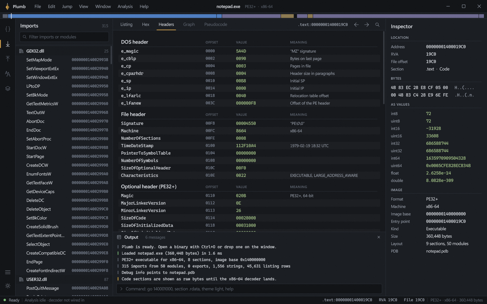
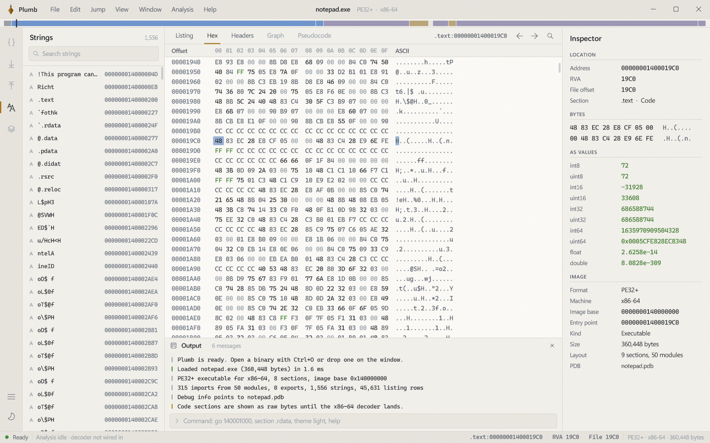

<p align="center">
  
</p>

<h1 align="center">Plumb</h1>

<p align="center">
  A binary analysis workbench for Windows, written from scratch in C++.<br>
  No C runtime, no dependencies, one executable of about 330&nbsp;KB.
</p>

<p align="center">
  
</p>

To plumb something is to measure how deep it goes. Plumb opens a Windows executable, maps it into memory and lays out everything inside it, from the DOS stub to the last import thunk, so you can read it the way a disassembler should let you.

This is the baseline: the interface and the file model are in place, and the x86-64 decoder is the next piece to land in the listing.

## What's here

- **A real PE loader.** PE32 and PE32+ images for x86, x86-64, ARM and ARM64. It reads headers, sections, imports (by name and ordinal), exports (including forwarders), TLS callbacks and the CodeView debug record, and scans the whole file for ASCII and UTF-16 strings. Anything that isn't a PE opens as raw bytes, and ELF and Mach-O are recognized and named.
- **Listing.** An IDA-style view of the whole image: section banners, labels for entry points, exports and strings, `extrn` rows for import slots, data rows with ASCII previews, and uninitialized space collapsed into `dup(?)`. Columns fit themselves to the window, and the cursor row glides between positions.
- **Hex view.** Bytes colored by class, click and drag selection, section boundaries marked, and it stays in step with the listing cursor.
- **Headers.** Every DOS, file and optional header field with its offset, raw value and meaning, plus decoded flags, timestamps, data directories and the section table.
- **Navigation band.** The whole address space as one strip, colored by section kind, with function ticks. Click or drag to jump.
- **Browser.** Functions, imports grouped by module, exports, strings and sections, each with a live filter and virtualized rows that stay quick with hundreds of thousands of entries.
- **Inspector.** Address, RVA, file offset, section and item kind for the cursor, the raw bytes, those bytes read as every integer and float type, and facts about the image.
- **Output and command line.** A load log, plus commands like `go 140001000`, `go start`, `section .rdata`, `view hex` and `theme light`.
- **Command palette and jump.** Ctrl+Shift+P for every command, G to jump to an address, an RVA like `+1A30`, or a symbol or section name. Alt+Left and Alt+Right walk the history.
- **Dark and light themes** that follow Windows on first launch and crossfade when you switch. Panels resize, collapse and give way when the window gets small, and the layout and recent files are remembered.

<table>
  <tr>
    <td width="50%"></td>
    <td width="50%"></td>
  </tr>
  <tr>
    <td align="center"><sub>Every header field, decoded</sub></td>
    <td align="center"><sub>Hex view and string search, light theme</sub></td>
  </tr>
</table>

## Building

Plumb shares its build setup with [Pearl](https://github.com/nn-nymph/pearl). You need Visual Studio 2022 (any edition, or the Build Tools) with **Desktop development with C++** and **C++ Clang tools for Windows**, plus a Windows 10 or 11 SDK.

```powershell
.\tools\build.ps1                         # build\release\Plumb.exe
.\tools\build.ps1 -configuration Debug    # build\debug\Plumb.exe
.\tools\style.ps1                         # house style check
```

Pass a path to open a file at startup (`Plumb.exe C:\Windows\System32\notepad.exe`), or drop one on the window. `--software` renders on the CPU for machines with broken graphics drivers.

## How it's put together

| Path | What's there |
| --- | --- |
| `src/runtime` | Entry point, allocator and the few C functions the compiler expects (no CRT) |
| `src/base` | Containers, text formatting, math, file I/O |
| `src/render` | Direct3D 11 and DirectComposition renderer, DirectWrite text |
| `src/image` | The binary model: file mapping, PE parsing, string scanning, address translation |
| `src/ui` | The app: chrome and menus, browser, listing, hex, headers, inspector, palette |
| `src/main.cc` | The window, input, frame pacing and graphics device recovery |
| `src/debug.cc` | Headless capture harness (Debug builds only) |

The UI is immediate-mode and draws only while something is moving. Every list draws its backgrounds before its text, which keeps Direct2D text batching cheap even in the densest views.

Debug builds can render without a window, which is how the screenshots here were made:

```powershell
.\build\debug\Plumb.exe --capture shot --size 1440x900 --script "open C:\Windows\System32\notepad.exe; wait 1; key ctrl+3; wait 1; shot headers"
```

## Next

1. The x86-64 decoder, filling the listing's code rows with real instructions.
2. Analysis: function discovery, cross-references and naming.
3. The control-flow graph view, then pseudocode on top of it.